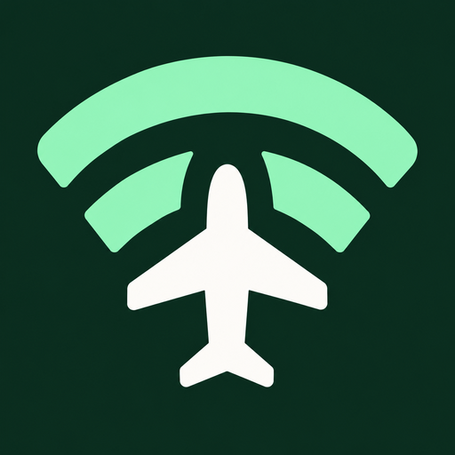
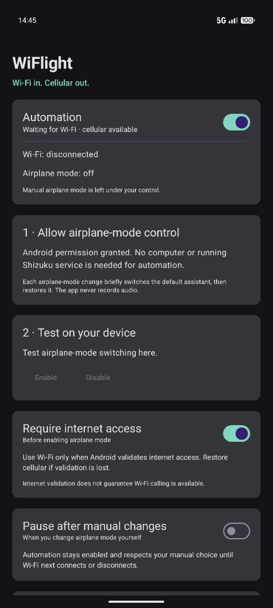
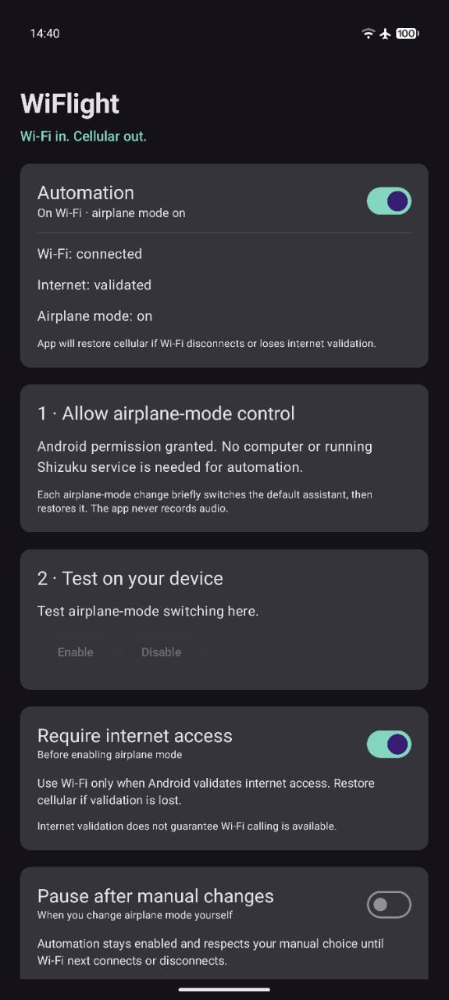
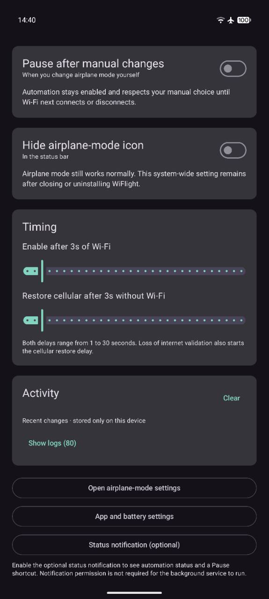

<h1> WiFlight</h1>

Automatically enable airplane mode on Wi-Fi and restore cellular connectivity when Wi-Fi is unavailable. Designed for devices with Wi-Fi calling. Can improve battery life, especially where cellular reception is weak.

Requires Android 14 or newer. No ads, analytics, or internet permission.

<p>
  <a href="fastlane/metadata/android/en-US/images/phoneScreenshots/1.jpg"></a>
  <a href="fastlane/metadata/android/en-US/images/phoneScreenshots/2.jpg"></a>
  <a href="fastlane/metadata/android/en-US/images/phoneScreenshots/3.jpg"></a>
</p>

## Behaviour

- Enables airplane mode after 3 seconds on Wi-Fi with validated internet access.
- Restores cellular after 3 seconds when Wi-Fi disconnects or loses internet access.
- Internet validation is optional; both delays are adjustable from 1–30 seconds.
- Automatically disables airplane mode only if WiFlight enabled it.
- Respects manual airplane-mode changes until Wi-Fi next connects or disconnects. Optionally pauses automation instead.
- Runs as a foreground service. An optional status notification provides automation status and a Pause shortcut.
- Optionally hides the airplane-mode status-bar icon using the same permission. This system setting persists after uninstalling.

Wi-Fi calling must be configured on your device; internet validation does not confirm that Wi-Fi calling is registered.

## How it works

WiFlight listens to Android’s network callbacks rather than repeatedly checking Wi-Fi. A foreground service keeps those callbacks available while the app is closed or the screen is off.

Notification permission is optional and is not required for the background service to run. You can enable or disable the visible status notification through Status notification (optional) in the app’s settings section. Android still requires the service to create a notification internally, even when permission to display it is denied.

Airplane-mode control uses Android’s assistant mechanism. After receiving `WRITE_SECURE_SETTINGS` permission through ADB or Shizuku, WiFlight:

1. Saves your current assistant settings.
2. Temporarily activates its minimal assistant service.
3. Requests airplane-mode switching through Android’s documented voice-control action.
4. Checks the result and restores your previous assistant.

The recovery record is saved before switching, allowing WiFlight to restore the assistant on its next launch if an operation is interrupted. It never records audio or requests screenshots.

Shizuku is only an optional permission-setup helper; automation does not require it to remain running.

## Setup

1. Install WiFlight from [GitHub Releases](https://github.com/jaqlig/wiflight/releases).
2. Grant the required airplane-mode control permission using the app’s Shizuku option, or run this ADB command:

   ```sh
   adb shell pm grant io.github.jaqlig.wiflight android.permission.WRITE_SECURE_SETTINGS
   ```

3. Remove battery restrictions when prompted.
4. Use the built-in test buttons to check airplane-mode switching, then enable automation.

Wi-Fi calling and airplane-mode control can vary by device and carrier. Force-stopping WiFlight stops monitoring until you reopen it.

## Build

Requires JDK 17 and Android SDK 36, configured through `ANDROID_HOME` or `local.properties`.

```sh
./gradlew assemblePreview
```

The optimized APK is generated at `app/build/outputs/apk/preview/app-preview.apk`. Preview builds use a development signing key.

## License

[GPL-3.0-only](LICENSE).
